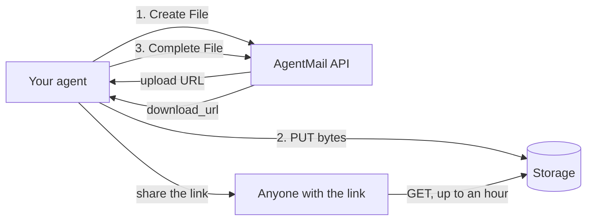

<Markdown src="../../snippets/drive-labs.mdx" />

## What is Agent Drive?

Every `Inbox` has a drive: a place to keep files by path, like `reports/q3.pdf`. Your agent uploads a file once and
can then list it, hand out a link to download it, and delete it, or let it expire on its own. The drive belongs to
the inbox and is deleted with it.

Files never pass through the API. Your agent asks the API for an upload URL, sends the bytes straight to storage,
then tells the API the upload is done. Downloads work the same way: the API returns a signed link that anyone holding
it can use, for up to an hour.



## Core concepts

### Files and paths

A file lives at a `path` in its inbox's drive, and a path holds one file at a time. Paths are separated by `/` like
folders, but there are no folder objects: a file at `reports/2026/q3.pdf` is all it takes, and listing with the prefix
`reports/` finds it. A path must not start or end with `/`, contain `//`, `.` or `..` segments, `\`, or control or
invisible characters. It can be up to 1,024 bytes, with up to 255 bytes per segment. Case is kept, and paths are
stored in Unicode NFC, so two spellings of the same accented name are the same path.

A file's `name` is the last segment of its path. A download saves under that name.

### Status

A file is `pending` from the moment it is created until its upload is completed, then `ready`. Only a `ready` file
can be downloaded. A pending file that isn't completed within a day is deleted, and its path freed.

### Who can see a file

Files belong to their inbox: a key scoped to one inbox or pod sees only that inbox's or pod's files. Within that
scope, the permissions decide the rest:

| Permission | Lets a key |
| --- | --- |
| `file_read` | List and get files, with their download URLs |
| `file_create` | Create and complete files |
| `file_delete` | Delete files |

A key with `file_create` but not `file_read` can upload files but never read them back. It can complete or delete
only files it created itself, and a create at a path another key's file holds returns a plain `409`, so it can't
learn anything about files it didn't create.

An organization created through [agent sign-up](/agent-onboarding) can't upload until it completes
[agent verification](/permissions#agent-verification): until then, no key has `file_create`. In an organization with a
content-access policy, organization- and pod-scoped keys have no file permissions, so only inbox-scoped keys can use
Agent Drive.

## Upload a file

An upload is three calls:

1. **Create File** with the file's `path`, `size` and `sha256` (the base64 of its SHA-256 digest). The response is a
   pending file with an `upload`: a URL and the exact headers to send.
2. **`PUT` the bytes** to `upload.url` with every header in `upload.headers`. Storage checks the size and the SHA-256
   and refuses bytes that don't match.
3. **Complete File.** The file is now `ready`, and for a key with `file_read` the response has its `download_url`.

<CodeBlocks>
```python title="Python"
import base64
import hashlib

import httpx
from agentmail import AgentMail

client = AgentMail()
inbox_id = "reports@agentmail.to"

with open("q3.pdf", "rb") as f:
    data = f.read()

file = client.inboxes.files.create(
    inbox_id,
    path="reports/q3.pdf",
    size=len(data),
    sha256=base64.b64encode(hashlib.sha256(data).digest()).decode(),
    content_type="application/pdf",
)
httpx.put(file.upload.url, headers=file.upload.headers, content=data).raise_for_status()

ready = client.inboxes.files.complete(inbox_id, file.file_id)
print(ready.download_url)
```

```typescript title="TypeScript"
import { createHash } from "node:crypto";
import { readFile } from "node:fs/promises";
import { AgentMailClient } from "agentmail";

const client = new AgentMailClient();
const inboxId = "reports@agentmail.to";

const data = await readFile("q3.pdf");

const file = await client.inboxes.files.create(inboxId, {
  path: "reports/q3.pdf",
  size: data.length,
  sha256: createHash("sha256").update(data).digest("base64"),
  contentType: "application/pdf",
});
const put = await fetch(file.upload!.url, {
  method: "PUT",
  headers: file.upload!.headers,
  body: new Uint8Array(data),
});
if (!put.ok) throw new Error(`Upload failed: ${put.status}`);

const ready = await client.inboxes.files.complete(inboxId, file.fileId);
console.log(ready.downloadUrl);
```
</CodeBlocks>

The upload URL works for up to an hour; `upload.expires_at` says when it stops. Files can be up to 100 MiB.

### Retries

Create File is safe to retry without a `client_id`. Sending the identical request again (same `path`, `size`,
`sha256`, `content_type` and `expires_at`) returns the file you already created, with `200` instead of `201`:

- **Still pending:** with a fresh `upload`, so a retry also replaces an expired upload URL.
- **Bytes uploaded but not completed:** the file is completed for you and returned `ready`.
- **Already `ready`:** the file as it is.

A different request at a path whose file is still pending and has no bytes replaces that file, so an upload that
went wrong never holds its path. At any other taken path, Create File returns `409`. Delete the file first, or pick
another path.

The `PUT` can't overwrite bytes already stored: a retried `PUT` whose first attempt landed returns `412`. A `412` means
the upload succeeded, so call Complete File (or resend the identical create) instead of starting over.

Complete File is safe to retry too: on a file that is already `ready`, it returns the file.

## Download a file

Get File returns a `ready` file with a `download_url` and the time it stops working, `download_expires_at`, at most an
hour later. Get the file again for a new link.

<CodeBlocks>
```python title="Python"
file = client.inboxes.files.get(inbox_id, "6f1c2f4e-8d3b-4a5e-9c7d-1b2a3c4d5e6f")
print(file.download_url, file.download_expires_at)
```

```typescript title="TypeScript"
const file = await client.inboxes.files.get(inboxId, "6f1c2f4e-8d3b-4a5e-9c7d-1b2a3c4d5e6f");
console.log(file.downloadUrl, file.downloadExpiresAt);
```
</CodeBlocks>

The link needs no API key, so anyone you share it with can download the file, and it always downloads as a file
with the file's `name`, never opening in the browser. Treat it as a secret: a link keeps working until it expires,
even if the file is deleted first.

## List files

List Files returns the inbox's files in path order, pending ones included. Pass `path_prefix` to narrow it: the prefix
matches characters, not whole segments, so `reports/q` matches `reports/q3.pdf`. Listed files carry no download URL;
get a file for one.

<CodeBlocks>
```python title="Python"
page = client.inboxes.files.list(inbox_id, path_prefix="reports/")
for file in page.files:
    print(file.path, file.size, file.status)
```

```typescript title="TypeScript"
const page = await client.inboxes.files.list(inboxId, { pathPrefix: "reports/" });
for (const file of page.files) {
  console.log(file.path, file.size, file.status);
}
```
</CodeBlocks>

A page holds up to `limit` files (100 by default, at most 500). When there are more, the response has a
`next_page_token`; pass it as `page_token` with the same `path_prefix` and `ascending` for the next page, in the same
inbox. A token reused with other parameters isn't always refused, and can resume at the wrong place.
`ascending=false` lists in reverse path order.

## Delete a file

Delete File removes a file, pending or `ready`, and frees its path at once. Its bytes are deleted within seconds.

<CodeBlocks>
```python title="Python"
client.inboxes.files.delete(inbox_id, "6f1c2f4e-8d3b-4a5e-9c7d-1b2a3c4d5e6f")
```

```typescript title="TypeScript"
await client.inboxes.files.delete(inboxId, "6f1c2f4e-8d3b-4a5e-9c7d-1b2a3c4d5e6f");
```
</CodeBlocks>

Deleting an inbox deletes every file in it.

## Expiring files

Pass `expires_at` to Create File and the file deletes itself then: from that moment it is gone from Get File and List
Files, its path is free, and its bytes are deleted soon after. `expires_at` must be in the future. It is rounded up to
a whole second and returned in UTC; when you retry a create, send the `expires_at` the first response returned. A
download link never outlives its file's expiry.

## Quota

Each organization's drives share one quota: by default **1 GiB and 10,000 files** across all its inboxes. A file counts from
the moment it is created, pending or not. A create that doesn't fit returns `403` with code `limit_exceeded`, and
the message says which limit it hit. To free space:

- Delete files you no longer need, including pending uploads you won't finish. A deleted file's space comes back
  within seconds.
- Expired files count until a create needs their space: a create that doesn't fit first gives back what expired
  files hold, a batch at a time, so retry a refusal while many expired files remain.

To raise your organization's limits, email [support@agentmail.cc](mailto:support@agentmail.cc).

## Limits and errors

| Limit | Value |
| --- | --- |
| File size | 100 MiB |
| Path | 1,024 bytes, 255 bytes per segment |
| Upload URL | Works for up to an hour (`upload.expires_at`) |
| Download URL | Works for up to an hour, never past the file's expiry |
| Pending file | Deleted if not completed within a day |
| Quota per organization | 1 GiB and 10,000 files by default, pending files included |

| Status | When |
| --- | --- |
| `400` | The request is invalid: a bad path, size, `sha256` or `expires_at`, or a `page_token` that is malformed or doesn't fit `path_prefix`. |
| `403` | The organization hasn't joined Labs, the key lacks the permission, the organization, pod or inbox is suspended, or the file doesn't fit the quota (`limit_exceeded`). |
| `404` | The inbox or the file doesn't exist, has expired, or isn't one the key may act on. |
| `409` | Create File: the path holds another file. Complete File: the bytes aren't uploaded yet, or don't match the file. |

Reads run in the region that serves the request, so for about a second after a delete a get can still return the
file, and a list can trail a create or a delete by about as long. An expired file is gone from both at once.
