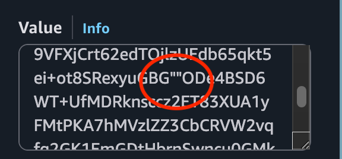
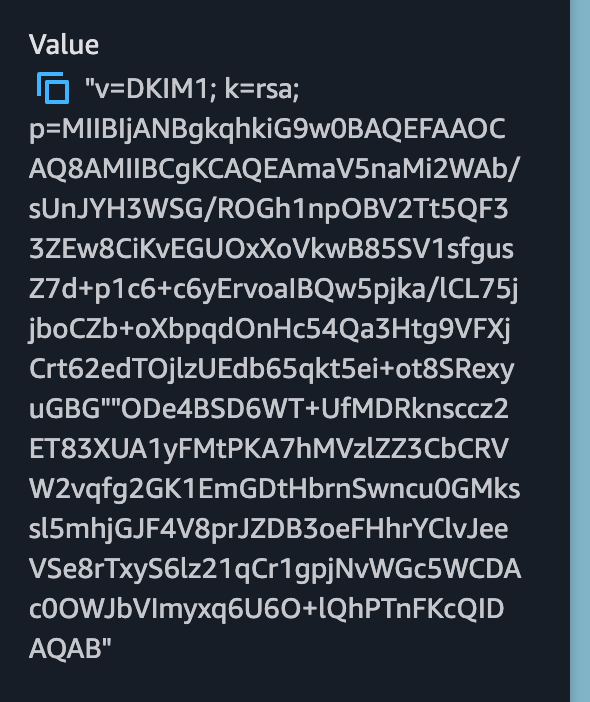

## Steps

1. Log in to the [AWS Management Console](https://console.aws.amazon.com)
2. Navigate to **Route 53**, then select **Hosted Zones**
3. Click on your domain's hosted zone
4. Click **Create Record** for each record AgentMail requires

<Note>
If your domain is registered with a different registrar but uses Route 53 for DNS, make sure the NS records at your registrar match the name servers listed in your hosted zone.
</Note>

## Records to add

<Markdown src="../../snippets/dns-records.mdx" />

## Adding the TXT records (SPF, DKIM, DMARC)

Create one TXT record for each row below:

| Record | Record name | Value |
| --- | --- | --- |
| SPF | `mail` | The SPF value from AgentMail, wrapped in double quotes |
| DKIM | The DKIM selector host from AgentMail (e.g., `selector._domainkey`) | The DKIM value from AgentMail, wrapped in double quotes |
| DMARC | `_dmarc` | The DMARC value from AgentMail, wrapped in double quotes |

Set **Record type** to `TXT` and **TTL** to `300` for each one.

<Warning>
Route 53 requires TXT values to be **wrapped in double quotes**. If you omit the quotes, the record will fail validation. If a DKIM TXT value is longer than 255 characters, split it into quoted strings on the same line of one TXT record (see [Common Route 53 Issues](#common-route-53-issues) below).
</Warning>

<Note>
Do not add anything to an existing SPF record on your root domain. AgentMail's SPF record goes on the `mail` record name, so your existing SPF for Google Workspace or another service stays exactly as it is.
</Note>

<Note>
Legacy orgs should keep existing working DNS records in place. For new domain setup, add the TXT selector records shown in AgentMail.
</Note>

## Adding the MX records (receiving and bounces)

Create one MX record for each row below:

| Record | Record name | Value |
| --- | --- | --- |
| Receiving | Leave blank for the root domain | `10` and the receiving MX value from AgentMail |
| Bounces (MAIL FROM) | `mail` | `10` and the `feedback-smtp` MX value from AgentMail |

Set **Record type** to `MX` and **TTL** to `300`. Skip the receiving MX if you created the domain as send-only (`inbound_enabled: false`). The `mail` MX must be the only value in the `mail` MX record.

Route 53 MX records combine the priority and mail server in one value, separated by a space: `10 <mail server from AgentMail>`. Do not wrap MX values in quotes.

If you registered a subdomain such as `agents.yourdomain.com` to avoid conflicts with your existing email provider, add the subdomain to every record name: `agents` (instead of leaving it blank), `mail.agents`, `_dmarc.agents`, and `selector._domainkey.agents`.

## Verification

After adding all records, go back to the [AgentMail Console](https://console.agentmail.to) and click **Verify Domain**.

Route 53 name servers typically pick up changes within **60 seconds**, but full propagation to all DNS resolvers may take longer depending on TTL and resolver caching. In practice, most changes are visible within a few minutes.

## Common Route 53 Issues

- **TXT records must be quoted:** Unlike most DNS providers, Route 53 requires double quotes around TXT record values. If your SPF, DKIM, or DMARC TXT records are missing quotes, they won't validate.

- **Existing SPF record on your root domain:** Leave it unchanged. Do not add `include:agentmail.to` or any other AgentMail value to it. If an earlier guide told you to add `include:agentmail.to`, remove that mechanism: `agentmail.to` publishes no SPF record, so the include causes an SPF permanent error.

- **Routing policy:** When creating records, use **Simple routing** unless you have a specific reason to use weighted, latency, or other routing policies. Other policies can cause unexpected DNS behavior for email records.

- **Multiple values in one record:** Route 53 lets you add multiple values to a single record. If you need to add a second MX entry on the same name, add it as a new line in the same MX record rather than creating a separate record. This does not apply to the `mail` MX record, which must hold only the AgentMail value.

- **DKIM TXT record too long (CharacterStringTooLong error):** Domains created before AgentMail moved to [1024-bit DKIM keys](/knowledge-base/dkim-key-size) have a DKIM record of about 400 characters, longer than the 255-character limit that Route 53 enforces per string segment, and you will see an error like `CharacterStringTooLong (Value is too long)`. Newer domains have a record under 255 characters and need no split. To fix the error on a longer record, split the value into two quoted strings within a single record. The split point should be near the middle of the `p=` value. Both quoted strings must be on the **same line**; a space between them is fine, a line break is not. For example:

  ```
  "v=DKIM1; k=rsa; p=MIIBIjANBgkqhki...firsthalf" "secondhalf...wIDAQAB"
  ```

  Writing the strings with no space between them (`...firsthalf""secondhalf...`) works too. Receiving servers join the strings back into one value either way.

  **Incorrect:** A line break between the two quoted strings. Each line in the Route 53 **Value** box is a separate TXT record, so the key ends up split across two records, neither of which holds the full key, and DKIM fails.

  **Entering the value:** Both quoted strings sit on one line of the **Value** box.

  

  **Saved record:** Route 53 shows a single value containing both strings.

  

  You can also use the AWS CLI to add the record, which handles multi-string TXT values more reliably.
